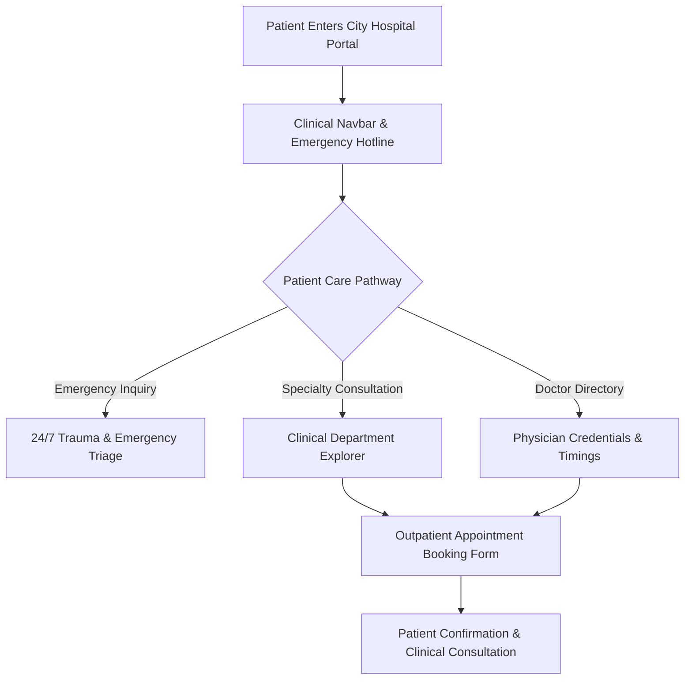

<div align="center">


[](https://developer.mozilla.org/en-US/docs/Web/HTML)
[](https://developer.mozilla.org/en-US/docs/Web/CSS)
[](#)
[](#)
[](#)

</div>

---

## 📌 Executive Summary / Overview

**City Hospital Healthcare Portal** (`FSD_CityHospital`) is an institutional healthcare and patient engagement web application designed to facilitate clinical discovery, medical staff directories, and outpatient appointment scheduling. Engineered during Full Stack Development (FSD) studies, the portal implements accessible, reassuring UI standards required in clinical digital experiences.

Patients navigating digital healthcare infrastructure require rapid access to emergency helplines, specialized clinical departments, certified doctor credentials, and transparent consultation booking. This repository implements structured HTML5 clinical sections, CSS3 responsive grid and flex layouts, emergency callout highlights, and doctor profile cards that emulate a modern hospital website.

---

## 📖 Interactive Table of Contents

- [Executive Summary / Overview](#-executive-summary--overview)
- [Key Features & Capabilities](#-key-features--capabilities)
- [System Architecture & Patient Care Pathway](#-system-architecture--patient-care-pathway)
- [Tech Stack Breakdown](#-tech-stack-breakdown)
- [Clinical Department Directory](#-clinical-department-directory)
- [Reproducible Quickstart & Setup](#-reproducible-quickstart--setup)
- [Project Directory Layout](#-project-directory-layout)
- [Author & Contributions](#-author--contributions)

---

## ✨ Key Features & Capabilities

- **Clinical Navigation Header**: Branded medical navbar linking specialized departments, medical staff directory, diagnostic services, emergency care, and appointment triggers.
- **Hero Consultation Call-to-Action**: High-visibility hero banner with direct "Book Appointment" triggers for expedited patient care access.
- **Departmental Medical Services**: Modular cards highlighting Cardiology, Orthopedics, Pediatrics, Neurology, and 24/7 Trauma Emergency services.
- **Physician Directory**: Displays verified physician profiles, medical specialties, years of clinical experience, and consultation hours.
- **Patient Inquiry & Booking Form**: Structured form elements for patient name, contact details, preferred department, and symptoms for scheduling triage.

---

## 🏗️ System Architecture & Patient Care Pathway



---

## 🛠️ Tech Stack Breakdown

| Category | Technologies & Tools |
| :--- | :--- |
| **Markup Language** | HTML5 (Semantic Headers, Forms, Fieldsets, Content Sections) |
| **Styling & Theme** | CSS3 (Medical Palette, Button Highlights, Responsive Breakpoints) |
| **UX Design** | Clinical Accessibility, High Contrast CTAs, Trust Typography |
| **Target Browsers** | Chrome, Edge, Safari, Firefox |

---

## 🏥 Clinical Department Directory

| Department | Medical Focus | Key Diagnostic & Treatment Capabilities |
| :--- | :--- | :--- |
| **Cardiology** | Cardiovascular Health | ECG, Echocardiography, Cardiac Catheterization, Heart Disease Management |
| **Orthopedics** | Musculoskeletal System | Joint Replacement, Fracture Triage, Arthroscopy, Physical Therapy |
| **Pediatrics** | Neonatal & Child Care | Vaccinations, Developmental Pediatrics, Pediatric ICU |
| **Neurology** | Nervous System | EEG, Stroke Intervention, Epilepsy Management, Cognitive Health |
| **Emergency Trauma** | Critical Care (24/7) | Advanced Life Support (ALS), Immediate Surgical Triage, Trauma Response |

---

## 🚀 Reproducible Quickstart & Setup

### Prerequisites
- Modern web browser

### Step 1: Clone the Repository
```bash
git clone https://github.com/Jeshwanthika07/FSD_CityHospital.git
cd FSD_CityHospital
```

### Step 2: Open in Browser
```bash
# On Windows
start cityhospitalupdated.html

# On macOS
open cityhospitalupdated.html

# On Linux
xdg-open cityhospitalupdated.html
```

---

## 📂 Project Directory Layout

```text
FSD_CityHospital/
│
├── cityhospitalupdated.html   # Primary hospital web portal structure and inline styles
└── README.md                  # Comprehensive medical portal documentation
```

---

## 👩‍💻 Author & Contributions

Authored by **[Jeshwanthika Pothamchetty](https://github.com/Jeshwanthika07)**  
*Alliance University | Department of Computer Applications*

<div align="center">


</div>
